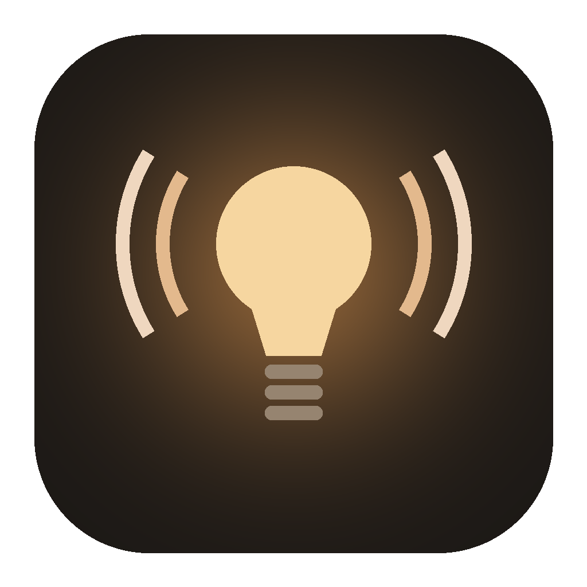
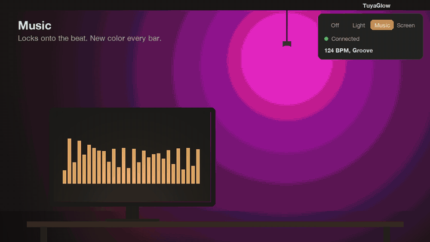

<p align="center"></p>

<h1 align="center">TuyaGlow</h1>

<p align="center"><b>Music sync, screen sync and simple controls for Tuya and Smart Life smart bulbs, on your Mac.</b><br>
Fully local. No cloud while it runs. Free and open source.</p>

<p align="center">
<a href="https://github.com/AviroopPaul/tuyaglow/releases/latest"></a>


<a href="LICENSE"></a>
</p>

<p align="center"></p>

TuyaGlow is a small menu bar app. It makes a Tuya Wi-Fi bulb react to the music playing on your Mac, follow the colors on your screen, or act as a normal bulb with whites and any color. It talks to the bulb directly on your Wi-Fi. Many smart bulbs sold in India and elsewhere are Tuya bulbs under another brand, so this works with a lot of them.

Website: **https://avirooppaul.github.io/tuyaglow/**

## Set up with an AI agent (fastest)

Paste this into Claude Code, Codex, Cursor or any coding agent on your Mac:

```text
Set up TuyaGlow on this Mac for my Tuya / Smart Life bulb by following the Setup section of https://github.com/AviroopPaul/tuyaglow.
Install the latest release, run scripts/get-local-key.py and guide me through the Smart Life QR scan,
then save my bulb's device ID, local key, IP and version into TuyaGlow ("For agents" in step 3) and confirm the bulb responds.
```

You only need to type your Smart Life User Code, scan one QR code, and allow Screen Recording. Prefer to do it by hand? See [Setup](#setup).

## Features

- **Music mode.** Locks onto the beat like a lighting desk. Pulses on every beat, new color on beat 1 of each bar. Breakdowns fade slowly, build-ups speed up, drops get a white strobe. Half-time on fast tracks. An **Intense** option also flashes on hi-hats.
- **Screen mode.** The bulb follows the main color on your display, like Ambilight. It follows the display your active window is on.
- **Light mode.** A normal bulb: five white shades from Candle to Cool, color swatches, the macOS color picker, brightness and power.
- **Local and fast.** Talks to the bulb on your Wi-Fi with Tuya's local protocol (3.3, 3.4 and 3.5). No Tuya cloud, no account login while it runs.
- **Finds your bulb.** Scans your Wi-Fi for Tuya devices and fills in the IP and protocol version. If the bulb gets a new IP, TuyaGlow finds it again.
- **Puts things back.** Turning sync off restores the bulb to how it was before.
- **Tiny.** A native Swift app. No Python, no Electron, no background service.

## Does my bulb work?

Your bulb probably works if:

- It is a **Wi-Fi** bulb (not Bluetooth or Zigbee).
- It pairs with the **Smart Life** or **Tuya Smart** app, or with a brand app built on Tuya.
- It is an RGB or RGBCW bulb (color plus white). White-only bulbs work in Light mode.

| Brand / bulb | App | Status |
|---|---|---|
| Wipro Smart RGBCW 9W | Wipro Next / Smart Life | **Tested.** Protocol 3.5 |
| Syska Smart LED | Smart Life | Reported to pair with Smart Life. Not tested yet |
| Unbranded "Smart Life" / "Tuya Smart" bulbs | Smart Life / Tuya Smart | Should work |

Tested your bulb? Please [open an issue](https://github.com/AviroopPaul/tuyaglow/issues) with the brand, model and protocol version so others know. TuyaGlow uses the common Tuya light data points (DP 20 to 28), which most color bulbs made since about 2019 use.

## Setup

You need a Mac with macOS 14 (Sonoma) or newer, and your bulb on the same Wi-Fi as the Mac.

### 1. Install TuyaGlow

1. Download **TuyaGlow-macos.zip** from the [latest release](https://github.com/AviroopPaul/tuyaglow/releases/latest).
2. Unzip it and move **TuyaGlow.app** to your Applications folder.
3. The app is not notarized by Apple. The first time, right-click it and choose **Open**, then **Open** again. Or run this in Terminal:
   ```bash
   xattr -dr com.apple.quarantine /Applications/TuyaGlow.app
   ```
4. A lightbulb icon appears in the menu bar. Click it to open TuyaGlow.

### 2. Get your bulb's device ID and local key

Tuya bulbs encrypt their local traffic with a **local key**. The bulb never shows it, so you get it once from your Smart Life account. This script uses the Smart Life app's QR sign-in, the same one Home Assistant's Tuya integration uses. You do **not** need a Tuya developer account.

1. Make sure your bulb is in the **Smart Life** or **Tuya Smart** app. If it is in a brand app (for example Wipro Next), remove it there and add it in Smart Life. It keeps working with Alexa and Google through Smart Life.
2. In Smart Life, find your **User Code**: **Me**, then the **settings gear**, then **Account and Security**, then **User Code**.
3. Run the script:
   ```bash
   git clone https://github.com/AviroopPaul/tuyaglow.git && cd tuyaglow
   python3 -m venv .venv
   .venv/bin/pip install tuya-device-sharing-sdk "qrcode[pil]" cryptography
   .venv/bin/python scripts/get-local-key.py
   ```
4. Type your User Code. A QR code appears.
5. In Smart Life, tap the **scan icon** (top right of Home), scan the QR code and tap **Confirm login**.
6. The script prints each device with its **Device ID**, **Local key**, IP and protocol version.

Keep the local key private. It changes if you remove and re-add the bulb in the app. If that happens, run the script again.

Already use [tinytuya](https://github.com/jasonacox/tinytuya)? Its `python -m tinytuya wizard` gives the same keys through a Tuya IoT developer account.

### 3. Connect TuyaGlow to the bulb

1. Open TuyaGlow and expand **Bulb settings**.
2. Paste the **Device ID** and **Local key**.
3. Click **Find on Wi-Fi**. It fills in the IP address and protocol version.
4. Click **Save**.

No device ID yet? Click **Find on Wi-Fi** with the field empty to list every Tuya device on your network.

**For agents.** The same settings can be written from Terminal, using the values the key script printed. Quit TuyaGlow first, then open it again:

```bash
defaults write site.aviroop.tuyaglow deviceID "<device id>"
defaults write site.aviroop.tuyaglow ip "<ip>"
defaults write site.aviroop.tuyaglow version "<3.3|3.4|3.5>"
security add-generic-password -U -s site.aviroop.tuyaglow -a localKey -T /Applications/TuyaGlow.app -w "<local key>"
open /Applications/TuyaGlow.app --args -startMode Light   # the bulb should turn on; check ~/Library/Logs/TuyaGlow.log
```

### 4. Allow Screen Recording

Pick **Music** or **Screen**. macOS asks to allow **Screen Recording** for TuyaGlow. This is how a Mac app hears the system sound and sees the screen. Turn it on in **System Settings > Privacy & Security > Screen Recording**, then pick the mode again. Audio and screen data stay on your Mac and are never saved.

### 5. Pick a mode

| Mode | What the bulb does |
|---|---|
| **Off** | Nothing. Your bulb goes back to how it was. |
| **Light** | Normal bulb. Whites, colors, brightness, power. |
| **Music** | Reacts to whatever plays on your Mac: Spotify, YouTube, Apple Music, games. Shows the tempo and section. |
| **Screen** | Follows the main color on your display. Choose a display or let it follow your active window. |

**Max brightness** limits how bright Music and Screen get. **Colors** picks the palette for Music.

## How it works

- **Local protocol.** TuyaGlow speaks Tuya's LAN protocol on TCP port 6668: AES-ECB with a CRC (3.3), session keys with HMAC (3.4), and session keys with AES-GCM (3.5). It is a Swift port of [tinytuya](https://github.com/jasonacox/tinytuya). Colors go to DP 28 (`control_data`), which changes the bulb instantly instead of fading.
- **Capture.** Apple's ScreenCaptureKit gives the system audio and a tiny 64 by 36 picture of the screen. Nothing is recorded.
- **Beat grid.** An onset envelope (kick-weighted bass plus broadband) feeds a tempo estimate by autocorrelation and a phase comb. TuyaGlow then fires on *predicted* beats, about 70 ms early to cover Wi-Fi and bulb delay. A quiet kick is not a missed flash. The bar's first beat is the slot with the strongest bass.
- **Sections.** Bass energy against its recent peak finds grooves and breakdowns. Rising highs in a breakdown mean a build-up. Bass slamming back means a drop.
- **Rate limit.** At most 10 changes a second (20 in Intense), so the bulb stays responsive.

## Troubleshooting

- **"The bulb did not answer" or "Check key and version".** The local key or protocol version is wrong. Run the key script again and use **Find on Wi-Fi**.
- **Find on Wi-Fi finds nothing.** The Mac and the bulb must be on the same network. Turn off VPNs (for example Cloudflare WARP) and guest-network isolation. Bulbs only use 2.4 GHz Wi-Fi, but your Mac can be on 5 GHz of the same router.
- **Slow to connect right after quitting.** A bulb accepts only a few local connections. After a quit, it can take about 10 seconds to accept a new one.
- **Netflix or Prime Video goes black in Screen mode.** Streaming apps block their video while any screen capture runs. This is copy protection. TuyaGlow cannot read those colors. Use Music or Light mode while you watch.
- **Music mode looks off for a song.** It needs about 3 seconds to lock onto the beat. Very free-tempo music (ambient, classical) has no steady grid, so it falls back to flashing on strong kicks.
- **Debug log.** `~/Library/Logs/TuyaGlow.log` records mode changes, displays, sections and drops.

## FAQ

**Does TuyaGlow work with Wipro smart bulbs?**
Yes. The Wipro Smart RGBCW 9W is tested. Wipro smart bulbs use the Tuya platform.

**Do I need a Tuya developer or IoT account?**
No. The key script uses the Smart Life app's QR sign-in. You only need it once.

**Does it use the internet or the Tuya cloud?**
Only the one-time key script talks to Tuya. The app itself only talks to your bulb on your Wi-Fi.

**Does it work on Windows or Linux?**
No, TuyaGlow is macOS only. On Windows, look at [OpenTuyaSync](https://github.com/parkzinc/OpenTuyaSync) or [LumiSync](https://github.com/Minlor/LumiSync).

**Can I control more than one bulb?**
Not yet. One bulb per setup in 0.1.0. Groups are on the list.

**Will the Smart Life app still work?**
Yes. TuyaGlow does not change the bulb's pairing.

## Build from source

```bash
git clone https://github.com/AviroopPaul/tuyaglow.git && cd tuyaglow
./build.sh            # builds build/TuyaGlow.app (universal)
open build/TuyaGlow.app
```

Needs Xcode command line tools (`xcode-select --install`). No packages, no Xcode project.

Developer tools in `Tools/`:

- `fake_device.py` is a fake Tuya bulb for protocol 3.3, 3.4 and 3.5, built on tinytuya. `prototest` talks to it or to a real bulb.
- `gridtest` runs the beat tracker on synthetic songs (buried kicks, tempos, breakdown, build, drop).
- `make_demo.py` renders the demo video.

## Contributing

Issues and pull requests are welcome. Most useful right now:

- Reports from more bulb brands and models.
- Older bulbs that use DP 1 to 5 instead of 20 to 28.
- Multiple bulbs and groups.

## Credits

- [tinytuya](https://github.com/jasonacox/tinytuya) by Jason Cox (MIT). The Tuya protocol code is a port of it.
- [tuya-device-sharing-sdk](https://pypi.org/project/tuya-device-sharing-sdk/) for the Smart Life QR sign-in.

TuyaGlow is not affiliated with Tuya, Smart Life, Wipro or Syska. Names are trademarks of their owners.

## License

[MIT](LICENSE)
